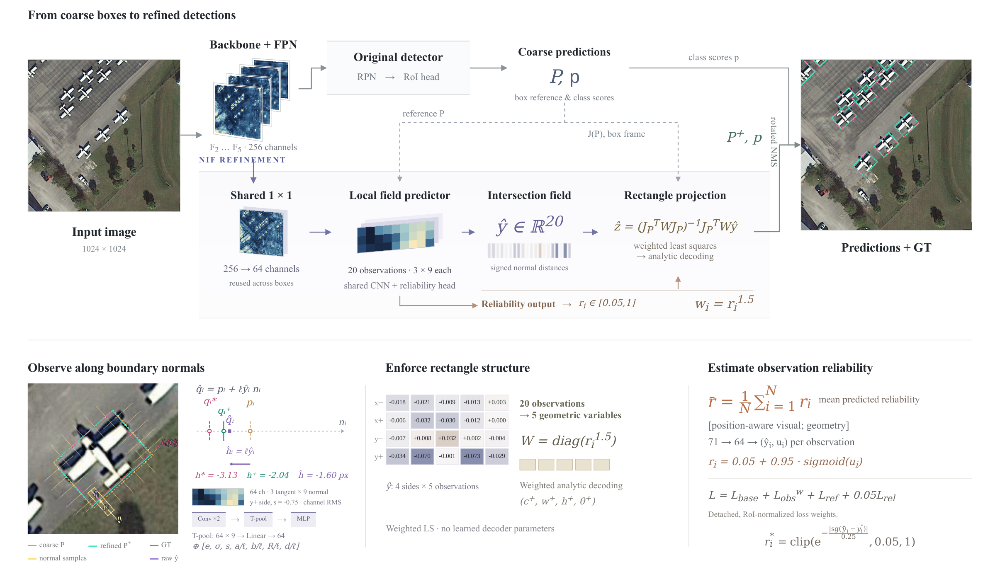

<div align="center">

<h1>NIF: Normal-Intersection Fields for Geometrically Consistent Oriented Box Refinement</h1>

<p>
  <strong>Shaokai Zheng<sup>*</sup></strong><br>
  Shanghai Zhongchao Automation Engineering Co., Ltd.<br>
  Shanghai, China<br>
  <a href="mailto:zsk@zc-sh.net">zsk@zc-sh.net</a><br>
  <sup>*</sup>Corresponding author
</p>

</div>

NIF is a plug-in geometric refinement branch. Given coarse oriented boxes and
feature maps, it predicts 20 normal-intersection observations and their
reliability, then fits a five-degree-of-freedom rectangle before the detector's
final postprocessing. The carrier's prediction head and class scores are retained.

This repository contains the final NIF implementation, four-dataset training
configs, frozen-detector experiments, and bundled Ultralytics and O2-RTDETR
runtimes. It contains no datasets, checkpoints, or training dashboard.

<p align="center">
  
</p>

<p align="center"><em>Figure 1. NIF framework for normal-intersection field based oriented box refinement.</em></p>

## Results and checkpoints

### DOTA-v1.0

Joint runs use trainval, single-scale 1024-pixel patches, and 36 epochs.
Frozen runs optimize only NIF: the values `baseline → NIF` use the same
pretrained detector. The FAA carrier is **LSKNet-S + FAA Head**.

| Method | Training | AP50 | AP75 | COCO mAP | Baseline | NIF | Baidu | Temporary |
|---|---|---:|---:|---:|---|---|---|---|
| Oriented R-CNN + NIF | Joint | 78.00 | — | — | [config](configs/baseline/dota/orcnn_r50.py) | [config](configs/nif/dota/orcnn_r50.py) | [pth](https://pan.baidu.com/s/1h5kacMBZX4Tye-uCMf3epg?pwd=v532) | [pth](https://ttttt.link/f/6ae1a7ab35fc4) |
| LSKNet-S + NIF | Joint | 79.11 | — | — | [config](configs/baseline/dota/lsknet_s.py) | [config](configs/nif/dota/lsknet_s.py) | [pth](https://pan.baidu.com/s/1F2YNUzaAN-kRC7AzNMwfDg?pwd=1v2j) | [pth](https://ttttt.link/f/6ae1a79631c14) |
| PKINet-v2-S + NIF | Joint | 78.18 | — | — | [config](configs/baseline/dota/pkinet_v2_s.py) | [config](configs/nif/dota/pkinet_v2_s.py) | — | — |
| Strip R-CNN + NIF | Joint | 79.02 | — | — | [config](configs/baseline/dota/strip_rcnn_s.py) | [config](configs/nif/dota/strip_rcnn_s.py) | [pth](https://pan.baidu.com/s/1vACdMqHr6yv8d3bsFTlg3g?pwd=c428) | [pth](https://ttttt.link/f/6ae1a89858ea3) |
| YOLO26-L OBB + NIF | Frozen | — | 59.19 → 60.12 | 54.18 → 54.41 | — | [config](adapters/ultralytics/train.py) | [pth](https://pan.baidu.com/s/1F28rvN1CxUOOynnB4IFnlQ?pwd=24rz) | [pth](https://ttttt.link/f/6ae1a839999f4) |
| O2-RTDETR + NIF | Frozen | — | 54.28 → 56.05 | 51.09 → 52.10 | — | [config](adapters/o2_rtdetr/configs/frozen_dota_36e.py) | [pth](https://pan.baidu.com/s/1Ir-F0NhJztXzT2hOBmwUXA?pwd=4dmd) | [pth](https://ttttt.link/f/6ae1a7386ae11) |
| LSKNet-S + FAA Head + NIF | Frozen | — | 51.88 → 54.05 | 48.35 → 50.16 | — | [config](configs/frozen/dota/lsknet_s_faa_36e.py) | [pth](https://pan.baidu.com/s/1vknYyx4IFUuyQ1WM573xFA?pwd=ib5b) | [pth](https://ttttt.link/f/6ae1a6fe4ab2a) |
| PKINet-v2-S + NIF | Frozen | — | 54.58 → 56.17 | 50.83 → 52.07 | — | [config](configs/frozen/dota/pkinet_v2_s_36e.py) | [pth](https://pan.baidu.com/s/1aTgzZiJ5hgElU4IbptS5gQ?pwd=9vqc) | [pth](https://ttttt.link/f/6ae1a7da87396) |

### FAIR1M-v1.0

Native multiscale preparation and testing use rates 0.5/1.0/1.5,
1024-pixel patches, and 500-pixel overlap. The supplied paper configs use
12 epochs; all 37 categories are predicted, with 34 scored officially.

| Method | mAP | Baseline | NIF | Baidu | Temporary |
|---|---:|---|---|---|---|
| Oriented R-CNN + NIF | 46.36 | [config](configs/baseline/fair/orcnn_r50.py) | [config](configs/nif/fair/orcnn_r50.py) | [pth](https://pan.baidu.com/s/19XQokxU9-heel2YPqnt9bA?pwd=xnzp) | [pth](https://ttttt.link/f/6ae1a81e16acb) |
| LSKNet-S + NIF | 48.13 | [config](configs/baseline/fair/lsknet_s.py) | [config](configs/nif/fair/lsknet_s.py) | [pth](https://pan.baidu.com/s/1tDeMNkVJ2JOEvZNvc5jO5Q?pwd=t9vc) | [pth](https://ttttt.link/f/6ae1a7965c8b0) |
| Strip R-CNN + NIF | 48.22 | [config](configs/baseline/fair/strip_rcnn_s.py) | [config](configs/nif/fair/strip_rcnn_s.py) | [pth](https://pan.baidu.com/s/1QIzWC3-MvLi_EP9T7XaVvQ?pwd=uux9) | [pth](https://ttttt.link/f/6ae1a887138dc) |
| PKINet-v2-S + NIF | — | [config](configs/baseline/fair/pkinet_v2_s.py) | [config](configs/nif/fair/pkinet_v2_s.py) | — | — |

### DIOR-R

Trainval training uses 800-pixel inputs and 12 epochs. Test-set evaluation
starts at epoch 9; the best checkpoint is recorded by the native evaluator.

| Method | mAP | Baseline | NIF | Baidu | Temporary |
|---|---:|---|---|---|---|
| Oriented R-CNN + NIF | 66.06 | [config](configs/baseline/dior/orcnn_r50.py) | [config](configs/nif/dior/orcnn_r50.py) | — | — |
| LSKNet-S + NIF | 68.19 | [config](configs/baseline/dior/lsknet_s.py) | [config](configs/nif/dior/lsknet_s.py) | [pth](https://pan.baidu.com/s/1sH99GD6xXG9QQ7QUJRZKSg?pwd=f56k) | [pth](https://ttttt.link/f/6ae1a79660880) |
| Strip R-CNN + NIF | 67.43 | [config](configs/baseline/dior/strip_rcnn_s.py) | [config](configs/nif/dior/strip_rcnn_s.py) | [pth](https://pan.baidu.com/s/1Sj6_L0mzdGBe39m31pSkEg?pwd=5peh) | [pth](https://ttttt.link/f/6ae1a8986ba84) |
| PKINet-v2-S + NIF | — | [config](configs/baseline/dior/pkinet_v2_s.py) | [config](configs/nif/dior/pkinet_v2_s.py) | — | — |

### HRSC2016

Use the standard 617-image trainval / 444-image test split, 800-pixel
inputs, learning rate 0.0001, and the final 36-epoch checkpoint.
Each metric cell below is **VOC2007 / VOC2012** interpolation.

| Method | AP50 | AP75 | COCO mAP | Baseline | NIF | Baidu | Temporary |
|---|---:|---:|---:|---|---|---|---|
| Oriented R-CNN + NIF | 90.50 / 98.30 | 89.70 / 92.20 | 74.33 / 78.09 | [config](configs/baseline/hrsc/orcnn_r50.py) | [config](configs/nif/hrsc/orcnn_r50.py) | — | — |
| LSKNet-S + NIF | 90.30 / 98.00 | 89.40 / 91.80 | 74.55 / 78.44 | [config](configs/baseline/hrsc/lsknet_s.py) | [config](configs/nif/hrsc/lsknet_s.py) | [pth](https://pan.baidu.com/s/1sRuT43qtp4v46KlfK1MDoA?pwd=h5g7) | [pth](https://ttttt.link/f/6ae1a7962d3d1) |
| PKINet-v2-S + NIF | 90.30 / 98.20 | 89.30 / 92.10 | 74.49 / 78.47 | [config](configs/baseline/hrsc/pkinet_v2_s.py) | [config](configs/nif/hrsc/pkinet_v2_s.py) | — | — |
| Strip R-CNN + NIF | 90.40 / 98.20 | 89.50 / 91.90 | 73.83 / 78.54 | [config](configs/baseline/hrsc/strip_rcnn_s.py) | [config](configs/nif/hrsc/strip_rcnn_s.py) | [pth](https://pan.baidu.com/s/1QP4FRKZvqhF3IG-TwHhUPQ?pwd=nd9z) | [pth](https://ttttt.link/f/6ae1a8a65434b) |

## Installation

### MMRotate and Ultralytics

The tested legacy environment uses Python 3.9, PyTorch 1.13.1 + CUDA 11.7,
MMCV-full 1.7.0, and MMDetection 2.28.2. Use a CUDA-enabled MMCV build.
From the repository root:

```bash
conda create -n nif python=3.9 -y
conda activate nif
pip install torch==1.13.1+cu117 torchvision==0.14.1+cu117 \
  --extra-index-url https://download.pytorch.org/whl/cu117
pip install mmcv-full==1.7.0 \
  -f https://download.openmmlab.com/mmcv/dist/cu117/torch1.13.0/index.html
pip install -r requirements.txt
pip install -e . --no-deps
pip install -r adapters/ultralytics/requirements.txt
```

The adapter selects the bundled Ultralytics runtime automatically. Keep O2's
MMCV 2.x dependencies in a separate environment (instructions below).

## Layout and paths

```text
NIF/
├── configs/{baseline,nif}/{dota,fair,dior,hrsc}/
├── configs/frozen/dota/
├── mmrotate/                  # two-stage detectors and shared NIF geometry
├── adapters/{ultralytics,o2_rtdetr}/
├── third_party/{ultralytics,o2_rtdetr}/
├── data/{dota,fair,dior,hrsc}/ # preparation code only
├── tools/                    # native train, test and submission tools
└── TRAINING_COMMANDS.txt
```

```bash
export NIF_DATA_ROOT=/path/to/processed_data
export NIF_PRETRAIN_ROOT=/path/to/pretrained
export NIF_WORK_ROOT=/path/to/work_dirs
```

Defaults are `data`, `pretrained`, and `work_dirs` relative to the working
directory. Run the commands from the NIF root. Place backbone initializations
in `NIF_PRETRAIN_ROOT`: `lsk_s_backbone.pth`, `strip_s_backbone.pth`,
`pkinet_v2_s_backbone.pth`, and the torchvision ResNet-50 initialization named in its
config. Full NIF checkpoints in the tables are for evaluation/resume;
backbone initialization checkpoints are separate files from the carrier projects.

## Data preparation

No datasets are distributed. The expected output layout is:

```text
processed_data/
├── dota/
│   ├── trainval/{images,annfiles}/ # sliced patches
│   └── test/images/               # original test images
├── fair/{trainval,test}/{images,annfiles}/
├── dior/{trainval,test}/{images,annfiles}/
└── hrsc/{ImageSets,FullDataSet/{AllImages,Annotations}}/
```

DOTA: edit the raw input directories in the native JSON files, then run:

```bash
python data/dota/split/img_split.py --base-json data/dota/split/split_configs/ss_trainval.json
```

Keep the original official test images under `dota/test/images`; the submission
tool creates 1024/200 windows in memory and merges them in original coordinates.
For the YOLO train/val experiment, prepare train and val separately using the
corresponding single-scale JSON files and convert polygon labels:

```bash
python data/dota/prepare_yolo.py --source "$NIF_DATA_ROOT/dota" \
  --images-source "$NIF_DATA_ROOT/dota" --output "$NIF_DATA_ROOT/yolo_dota10"
```

FAIR1M: use the native converter/splitter through the batch preparation helper.
It creates the manifest required for correct original-image XML export:

```bash
python data/fair/prepare.py --source /path/to/FAIR1M1.0 \
  --output "$NIF_DATA_ROOT/fair" --mode ms
```

DIOR-R: convert XML annotations and create the image/annotation split layout:

```bash
NIF_DIOR_SOURCE=/path/to/DIOR-R python data/dior/prepare.py
```

HRSC2016: use the official standard dataset, including `ImageSets/trainval.txt`
and `ImageSets/test.txt`. Images and XML stay in `FullDataSet`.

## Training and evaluation

MMRotate configurations use AdamW, learning rate 0.0001, weight decay 0.05,
and two images per GPU. The learning rate is kept fixed for four GPUs.
See [all commands](TRAINING_COMMANDS.txt) for every dataset/carrier and
single-/four-GPU commands. Example:

```bash
CUDA_VISIBLE_DEVICES=0,1,2,3 bash tools/dist_train.sh \
  configs/nif/dota/lsknet_s.py 4 --no-validate \
  --work-dir "$NIF_WORK_ROOT/nif_lsknet_s_dota" \
  --cfg-options data.samples_per_gpu=2
```

DOTA and FAIR test sets are unlabeled: disable training-time validation and
export submissions. DIOR-R performs native test evaluation from epoch 9;
HRSC evaluates the final checkpoint with both AP interpolations.

```bash
python tools/nif_submit.py configs/nif/dota/lsknet_s.py \
  /path/to/nif_checkpoint.pth --output "$NIF_WORK_ROOT/dota_submission" --device cuda:0
python tools/fair_submit.py configs/nif/fair/lsknet_s.py \
  /path/to/nif_checkpoint.pth --output "$NIF_WORK_ROOT/fair_submission" --device cuda:0
bash tools/dist_test.sh configs/nif/dior/lsknet_s.py /path/to/checkpoint.pth 4 --eval mAP
bash tools/dist_test.sh configs/nif/hrsc/lsknet_s.py /path/to/epoch_36.pth 4 \
  --eval mAP --eval-options use_07_metric=both \
  'iou_thr=[0.5,0.55,0.6,0.65,0.7,0.75,0.8,0.85,0.9,0.95]'
```

DOTA writes a ZIP containing 15 `Task1_<class>.txt` files. FAIR writes
`test.zip` containing `test/<original-image-id>.xml`, one XML per image.
The FAIR exporter preserves native crop coordinates; it does not divide
coordinates by the multiscale rate a second time. `--limit` runs smoke
inference and deliberately produces no official submission archive.

### Frozen two-stage carriers

Use the exact official 15-class DOTA carrier checkpoint:
`lsk_s_dota_12.pth` for **LSKNet-S + FPN + FAA Head**, or
`pkinet-v2-s_o-rcnn_dotav1.pth` for **PKINet-v2-S + Oriented R-CNN**.
Both 12- and 36-epoch configs are provided in `configs/frozen/dota`.
All detector parameters and normalization buffers stay fixed. A strict
carrier check rejects missing/mismatched detector tensors, and the optimizer
contains only `roi_head.nif_head` parameters.

```bash
CUDA_VISIBLE_DEVICES=0,1,2,3 bash tools/dist_train.sh \
  configs/frozen/dota/lsknet_s_faa_36e.py 4 --no-validate \
  --work-dir "$NIF_WORK_ROOT/frozen_lsknet_faa" \
  --cfg-options data.samples_per_gpu=2
```

### Ultralytics YOLO26-OBB

The paper experiment freezes `yolo26l-obb.pt`, trains NIF for 50 epochs,
uses train/val splits, global batch 32 (8/GPU), validates every epoch,
and retains `max_det=700`. Augmentation uses mosaic 1.0, mixup 0.15,
and `close_mosaic=5`; AdamW uses lr 0.001 and weight decay 0.0005.
To use two images per GPU instead, set global `--batch 8`.

```bash
python adapters/ultralytics/train.py --model "$NIF_PRETRAIN_ROOT/yolo26l-obb.pt" \
  --data "$NIF_DATA_ROOT/yolo_dota10/DOTA10_nif.yaml" \
  --device 0,1,2,3 --batch 32 --epochs 50 --val-interval 1 --max-det 700 \
  --project "$NIF_WORK_ROOT/yolo_nif" --name train
```

The downloaded YOLO NIF checkpoint stores Python model objects. Convert its
module references once before loading it from a clean checkout:

```bash
python adapters/ultralytics/convert_checkpoint.py /path/to/downloaded.pt \
  "$NIF_PRETRAIN_ROOT/yolo_nif.pt"
python adapters/ultralytics/infer_dota.py --weights "$NIF_PRETRAIN_ROOT/yolo_nif.pt" \
  --images "$NIF_DATA_ROOT/dota/test/images" --output "$NIF_WORK_ROOT/yolo_submission" \
  --devices 0,1,2,3 --batch-size 8 --max-det 700
```

The adapter keeps geometry and the weighted linear solve in FP32 under AMP.
The native YOLO validation metrics and official DOTA server metrics use their
respective evaluation implementations; the table reports the official server.

### O2-RTDETR

Use a separate Python environment with PyTorch 1.13.1/CUDA 11.7,
MMCV 2.1.0, MMEngine 0.10.7, and MMDetection 3.3.0:

```bash
pip install mmcv==2.1.0 \
  -f https://download.openmmlab.com/mmcv/dist/cu117/torch1.13.0/index.html
pip install -r adapters/o2_rtdetr/requirements.txt
```

Do not install the legacy `mmrotate` package in this environment. The entry
point selects the bundled O2 runtime and imports the shared NIF geometry
without importing the legacy registry.

```bash
export NIF_O2_CHECKPOINT="$NIF_PRETRAIN_ROOT/epoch_72.pth"
CUDA_VISIBLE_DEVICES=0,1,2,3 python -m torch.distributed.launch \
  --nproc_per_node=4 --master_port=29601 adapters/o2_rtdetr/run.py train \
  adapters/o2_rtdetr/configs/frozen_dota_36e.py --launcher pytorch \
  --work-dir "$NIF_WORK_ROOT/o2_nif"
CUDA_VISIBLE_DEVICES=0,1,2,3 python -m torch.distributed.launch \
  --nproc_per_node=4 --master_port=29601 adapters/o2_rtdetr/run.py test \
  adapters/o2_rtdetr/configs/frozen_dota_36e.py --launcher pytorch \
  --checkpoint "$NIF_WORK_ROOT/o2_nif/epoch_36.pth" \
  --work-dir "$NIF_WORK_ROOT/o2_submission"
```

O2 uses two images per GPU, lr 0.0001, AdamW weight decay 0.05,
and 36 epochs with drops at 24/33. The strict loading hook verifies every
carrier tensor; only the new NIF parameters are initialized and trained.

## Acknowledgements

We thank the authors and maintainers of the following open-source projects:

- [Ultralytics](https://github.com/ultralytics/ultralytics)
- [MMRotate](https://github.com/open-mmlab/mmrotate)
- [MMDetection](https://github.com/open-mmlab/mmdetection)
- [Fourier Angle Alignment](https://github.com/gcy0423/Fourier-Angle-Alignment)
